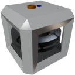

  

|Component| `Gyroscope`|
|---|---|
|**Module**|`ARCHEAN_gyroscope`|
|**Mass**|200 kg|
|[**Size**](# "Based on the component's occupancy in a fixed 25cm grid.")|100 x 100 x 100 cm|
#
---

# Description
The gyroscope is a component that, when powered and active, dampen its angular velocity. It is mainly used to stabilize a vehicle or stop angular momentum in zero G.

# Power Supply
The Gyroscope is powered via **high voltage**. It consumes more power at startup then gradually reduces its consumption as it reaches the rotation speed requested via the data port.

# Usage
To start the gyroscope, it must receive a value between `0.0` and `1.0` in its data port to decrease/increase its rotation speed, thereby increasing its stabilizing effect.

The gyroscope allows for manually orienting a vehicle through its data port by harnessing the induced torque of the inertial wheels inside it. It will act based on its orientation and rotation speed.

### List of inputs
|Channel|Function|range|
|---|---|---|
|0|Speed| 0.0 to 1.0|
|1|Control| -1.0 to +1.0|

### List of outputs
|Channel|Function|range|
|---|---|---|
|0|Rotation Speed| 0.0 to 10.0 rot/s|

>A gyroscope has a limited effect relative to the weight of the build. You can increase the number of gyroscopes to increase the stabilizing effect.
