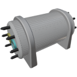

  

|Component|`Electrolyser`|
|---|---|
|**Module**|`ARCHEAN_chemical`|
|**Mass**|500 kg|
|[**Size**](# "Based on the component's occupancy in a fixed 25cm grid.")|100 x 100 x 200 cm|
|**Push/Pull Fluid**|Initiate Push/Pull|
#
---

# Description
Electrolyser — компонент, позволяющий расщеплять воду на водород и кислород.

# Usage
Electrolyser требует высоковольтного питания и потребляет до 16 МВт во время работы. Производительность линейно пропорциональна доступной мощности, максимум 1 кг воды в секунду при 16 МВт, то есть около 40 кВт·ч на кг водорода. Для работы нужно не менее 1 кВт: ниже этого порога он ничего не производит.

Для запуска процесса электролиза просто подключите источник воды к синему входному порту. Источником может служить [Fluid Port](../fluids/FluidPort.md), погружённый в воду (например, для прямого забора воды из моря), или резервуар с водой.

Произведённые водород и кислород можно собирать соответственно с жёлтого (H2) и голубого (O2) выходных портов.

### Производство
Electrolyser может обрабатывать до 1 кг воды в секунду, производя приблизительно [0,9 кг кислорода и 0,1 кг водорода](# "O2:0.88kg / H2:0.11kg") в секунду.

Когда оба выходных бака заполнены, Electrolyser переходит в режим ожидания на 50 Вт и сам возобновляет работу, как только один из них снова принимает газ.

### List of inputs
|Channel|Function|Range|
|---|---|---|
|0|Уставка мощности, доля от номинальных 16 МВт (0 = выключен, 1 = всё, что даёт источник)|0.0 до 1.0|

### List of outputs
|Channel|Function|
|---|---|
|0|Потребляемая мощность (Вт)|
|1|Обработанная вода (кг/с)|
|2|Произведённый водород (кг/с)|
|3|Произведённый кислород (кг/с)|
