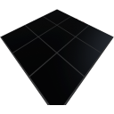

  

|Component|`SolarPanel`|
|---|---|
|**Module**|`ARCHEAN_celestial`|
|**Mass**|25 kg|
|[**Size**](# "Based on the component's occupancy in a fixed 25cm grid.")|200 x 200 x 25 cm|
#
---

# Description
Solar Panel 产生低压能量。它的效率为 50%，表面积为 4 平方米（2x2 米）。
功率输出将根据其与太阳的距离和朝向而受到限制。
太阳具有真实的辐照度（在地球轨道上约为 1390 W/m²）。在 Archean 的地球大气层内最佳条件下，每块面板最高可产生约 2700 瓦，在没有大气层的月球上约为 2780 瓦。浸入水中的面板不产生任何电力。

# Usage
将 Solar Panel 连接到需要低压能量运行的组件。

Solar Panel 有两个电气端口，允许您同时连接两个组件或将多个 Solar Panel 串联以增加总可用功率。

### List of outputs
|Channel|Function|
|---|---|
|0|Generated Power (Watts)|
|1|Output Power (Watts)|

> 如果您使用 Solar Panel 为两个组件供电，两个端口分配的总功率不能超过面板的输出功率。
>
> 如果两个组件之一想要消耗面板的全部可用功率，可能会导致另一个组件完全无法使用电力。在这种情况下，最好使用电力 Junction，以确保所有组件均等地获得电力。
